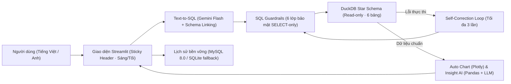

# 📊 DACS4 — Automated Data Insights Engine

> Hệ thống phân tích dữ liệu thương mại điện tử Olist thông minh theo kiến trúc **Client–Server & AI Agent**: đặt câu hỏi tự nhiên bằng tiếng Việt hoặc tiếng Anh, tự động sinh truy vấn **SQL an toàn**, thực thi trên **DuckDB Star Schema**, tự sửa lỗi, trực quan hóa bằng **Plotly**, tóm tắt **Insight** và lưu vết lịch sử bền vững qua **MySQL 8.0 / SQLite**.


---

## 🎯 Tổng quan & Điểm nổi bật

- **Text-to-SQL song ngữ (Việt / Anh):** Tích hợp Google Gemini Flash cùng kỹ thuật Schema Linking và Few-shot Prompting chính xác cao trên lược đồ Star Schema 6 bảng của Olist.
- **SQL Guardrails 6 lớp:** Chỉ cho phép `SELECT` / CTE; chặn từ khóa DDL/DML nguy hiểm, stacked queries, comment injection, hàm đọc file (`read_csv`, `glob`...), xác thực bảng & `alias.column`, giới hạn JOIN/subquery và tự thêm `LIMIT 1000` + timeout 30 giây.
- **Self-Correction Loop (tối đa 3 vòng):** Tự động phân loại lỗi thực thi (`syntax`, `unknown_table`, `unknown_column`, `type_mismatch`, `timeout`) kèm gợi ý ngữ cảnh để LLM sửa SQL; dừng ngay nếu vi phạm bảo mật.
- **Auto Visualization & Insight 2 bước:** Phân loại 9 dạng biểu đồ bằng luật xác định (nhanh, không tốn API) rồi vẽ bằng Plotly; thống kê trước bằng Pandas trước khi LLM diễn đạt thành nhận xét tiếng Việt (tránh bịa số liệu).
- **Lịch sử bền vững (MySQL 8.0 + SQLite fallback):** Tách biệt kho OLAP chỉ đọc (`olist_analytics.duckdb`) khỏi CSDL lưu vết hỏi đáp (`MySQL 8.0` ưu tiên, tự động chuyển êm sang SQLite `query_history.db` khi chưa cấu hình hoặc mất kết nối MySQL).

---

## 🏗️ Kiến trúc hệ thống



---

## 🛠️ Công nghệ sử dụng

| Thành phần | Công nghệ & Vai trò |
|---|---|
| **Kho dữ liệu phân tích (OLAP)** | **DuckDB** (`read_only=True`), ETL tiền xử lý **Pandas / Polars / PyArrow** trên bộ dữ liệu Olist Brazilian E-Commerce |
| **Mô hình AI / Text-to-SQL** | **Google GenAI SDK (`google-genai`)** với `gemini-3.5-flash-lite` (mặc định, nhanh) và chuỗi dự phòng `gemini-3.5-flash` |
| **Bảo mật & Phân tích cú pháp SQL** | **SQL Guardrails (`sqlparse`)** kết hợp danh sách trắng/đen, kiểm tra AST & kiểm soát độ phức tạp |
| **Trực quan hóa & Thống kê** | **Plotly** (9 loại biểu đồ tự động đồng bộ theme Sáng/Tối) + **Pandas** tính thống kê/IQR outlier |
| **Giao diện Web** | **Streamlit** (Sticky Header bám cuộn, Dark/Light Mode, 3 không gian làm việc) |
| **CSDL Lưu lịch sử phiên** | **MySQL 8.0 (`pymysql` + `cryptography`)** làm backend chính và **SQLite** tự động dự phòng |
| **Kiểm thử & Đánh giá** | **Pytest**, `streamlit.testing.v1.AppTest`, script benchmark 40 câu hỏi |

---

## 💻 Giao diện ứng dụng

Ứng dụng có **Sticky Header** cố định khi cuộn trang kèm nút chuyển **Sáng / Tối (`☀️ Sáng` / `🌙 Tối`)**, chia thành 3 không gian làm việc (`st.segmented_control`):

- **💬 Hỏi đáp Phân tích:** Màn hình chào với 4 thẻ KPI sống từ DuckDB Olist và 3 thẻ gợi ý nhanh; mỗi lượt hỏi hiển thị thẻ kết quả gồm badge trạng thái/độ trễ, 4 tab (**📈 Biểu đồ** Plotly thích ứng theme + tải HTML, **📋 Dữ liệu** + tải CSV UTF-8 BOM, **🧾 SQL** đã format + badge Guardrails, **💡 Insights** + thống kê Pandas) và chi tiết độ trễ từng bước. Tự động lưu và khôi phục tối đa 50 lượt hỏi gần nhất khi F5 / khởi động lại.
- **🗂️ Star Schema & Dữ liệu:** Trực quan hóa sơ đồ 1 bảng Fact (`fact_orders`) và 5 bảng Dimension (`dim_*`), xem từ điển cột (Metadata) và dữ liệu mẫu 10 dòng trực tiếp từ DuckDB.
- **🛡️ Hệ thống & Hiệu năng:** Thống kê Self-Correction tổng hợp từ lịch sử đã lưu, danh sách 6 lớp bảo vệ SQL Guardrails, thẻ theo dõi trạng thái CSDL đang dùng (`MySQL` hoặc `SQLite` fallback & đường dẫn `DuckDB`), bảng nhật ký truy vấn (tải CSV) và biểu đồ so sánh độ trễ.
- **Thanh bên (Sidebar):** Thẻ trạng thái DuckDB, chọn model Gemini, bật/tắt cache & Insight, cấu hình số lần tự sửa SQL, 4 câu hỏi gợi ý nhanh, danh sách lịch sử đã lưu và nút xóa lịch sử.

---

## 📈 Kết quả Đánh giá Thực nghiệm (Tuần 6)

Đo kiểm chuẩn trên bộ **40 câu hỏi** ([tests/test_questions.json](tests/test_questions.json)) với `gemini-3.5-flash-lite` (`LLM_CACHE=False`, `--delay 3.2s`):

| Nhóm câu hỏi | Số câu | Không Self-Correction | Có Self-Correction |
|---|---:|---:|---:|
| Dễ (Easy) | 12 | 12/12 (100.0%) | 12/12 (100.0%) |
| Trung bình (Medium) | 12 | 11/12 (91.7%) | 12/12 (100.0%) |
| Khó (Hard) | 11 | 10/11 (90.9%) | 10/11 (90.9%) |
| **Tổng chuẩn (Easy + Medium + Hard)** | **35** | **33/35 (94.3%)** | **34/35 (97.1%)** |
| Edge Cases (Bảo mật / Ngoài schema / Rỗng) | 5 | 3/5 (60.0%) | 3/5 (60.0%) |

- **Độ trễ (`with_correction`):** End-to-End Mean **1.32s**, P50 **1.30s**, P90 **1.53s**, P99 **1.70s** (riêng DuckDB + Guardrails trung bình chỉ **80.6 ms**).
- Lệnh chạy lại benchmark:
  ```powershell
  python run_benchmark.py --mode compare --model gemini-3.5-flash-lite --delay 3.2
  ```
- Báo cáo chi tiết và biểu đồ HTML xem tại [results/BENCHMARK_REPORT.md](results/BENCHMARK_REPORT.md).

---

## 🚀 Hướng dẫn Cài đặt & Chạy nhanh

### 1. Cài đặt thư viện
Yêu cầu **Python 3.10+** (nếu dùng MySQL cần thêm MySQL Server đang chạy, ví dụ `MySQL80`):

```powershell
cd "D:\Project _Lab_Doc\DA\DACS4"
python -m pip install -r requirements.txt
```

### 2. Cấu hình biến môi trường (`.env`)
Sao chép `.env.example` thành `.env` (không commit `.env` lên Git):

```powershell
Copy-Item .env.example .env
```

Điền `GEMINI_API_KEY` (hoặc `GOOGLE_API_KEY`). Các tùy chọn cấu hình gồm:

**Cấu hình Gemini & tốc độ phản hồi:**

| Biến môi trường | Mặc định | Ý nghĩa |
|---|---|---|
| `GEMINI_MODEL` | `gemini-3.5-flash-lite` | Model chính (~1.3–1.6s/câu) |
| `GEMINI_FALLBACK_MODEL` | `gemini-3.5-flash-lite,gemini-3.5-flash` | Chuỗi model dự phòng (`none` để tắt) |
| `GEMINI_TIMEOUT` | `20` | Thời gian chờ tối đa mỗi request (giây, tối thiểu `10`) |
| `GEMINI_THINKING_LEVEL` | _(trống)_ | Mức thinking (ví dụ `low`) |
| `LLM_CACHE` | `1` | Cache phản hồi tại `cache/llm_responses/` (`0` để tắt) |

**Cấu hình MySQL lưu lịch sử (tùy chọn; bỏ trống hoặc lỗi kết nối tự fallback về SQLite):**

| Biến môi trường | Mặc định | Ý nghĩa |
|---|---|---|
| `HISTORY_BACKEND` | `auto` | `auto`, `mysql` hoặc `sqlite` |
| `MYSQL_HOST` | _(trống)_ | Địa chỉ MySQL Server (ví dụ `127.0.0.1`) |
| `MYSQL_PORT` | `3306` | Cổng kết nối MySQL |
| `MYSQL_USER` | `root` | Tên tài khoản MySQL |
| `MYSQL_PASSWORD` | _(trống)_ | Mật khẩu tài khoản MySQL |
| `MYSQL_DATABASE` | `dacs4_insights` | Tên schema tự khởi tạo chứa bảng `query_history` |

### 3. Chạy pipeline dữ liệu Olist (nếu chưa có DuckDB)
Nếu chưa có sẵn file `data/database/olist_analytics.duckdb`, chạy lần lượt:

```powershell
python -m src.data.download_dataset
python -m src.data.clean_data
python -m src.data.star_schema
```

*(Có thể bỏ qua `download_dataset` nếu 9 file CSV gốc đã nằm sẵn trong `data/raw/`.)*

### 4. Khởi chạy giao diện web

```powershell
streamlit run app.py
```

Hoặc dùng nhanh Text-to-SQL pipeline trong Python:

```python
from src.models.text_to_sql import create_pipeline

pipeline = create_pipeline()
result = pipeline.run("Top 5 danh mục sản phẩm có doanh thu cao nhất?")
print(result.success, result.generated_sql)
print(result.dataframe)
print(result.chart_spec.chart_type)
print(result.insights.text)
```

### 5. Kiểm thử & chẩn đoán

```powershell
# Chạy toàn bộ 185 unit tests offline (loại trừ 2 test gọi Gemini API thật ở Tuần 2)
python -m pytest tests -v -k "not test_generate_sql_structure and not test_full_pipeline_integration"

# Kiểm tra trạng thái backend lịch sử (MySQL / SQLite) và 5 bản ghi gần nhất
python -m src.ui.history_store

# Kiểm tra schema metadata và EDA
python -m src.data.schema_metadata
python -m src.data.eda
```

---

## 📁 Cấu trúc dự án

```text
DACS4/
├─ app.py                       # Giao diện web Streamlit chính
├─ run_benchmark.py             # Script đánh giá 40 câu hỏi (Tuần 6)
├─ requirements.txt             # Danh sách thư viện Python
├─ pytest.ini                   # Cấu hình pytest
├─ .env.example                 # Mẫu biến môi trường (Gemini + MySQL)
├─ .streamlit/config.toml       # Theme Light mặc định cho Streamlit
├─ data/
│  ├─ raw/                      # Dữ liệu CSV gốc Olist (gitignored)
│  ├─ processed/                # Dữ liệu Parquet đã làm sạch (gitignored)
│  └─ database/                 # olist_analytics.duckdb & query_history.db (gitignored)
├─ src/
│  ├─ data/                     # download_dataset, clean_data, star_schema, schema_metadata, eda
│  ├─ models/                   # llm_client, prompt_templates, text_to_sql,
│  │                            # sql_guardrails, self_correction, insight_generator
│  ├─ visualization/            # chart_classifier, chart_generator (Plotly)
│  ├─ ui/                       # history_store (MySQL / SQLite fallback), services, styles
│  └─ evaluation/               # evaluator (EX, latency), report (Markdown & biểu đồ HTML)
├─ tests/                       # Bộ câu hỏi test_questions.json & unit tests Tuần 1–6
├─ results/                     # BENCHMARK_REPORT.md, JSON/CSV & charts/
└─ docs/                        # STAR_SCHEMA.md, WEEK1_SUMMARY.md
```

---

## 📅 Tiến độ dự án

| Tuần | Nội dung chính | Trạng thái | Tiến độ |
|:---:|---|:---:|:---:|
| 1 | Thu thập, làm sạch dữ liệu Olist, Star Schema & DuckDB | Hoàn thành | 100% |
| 2 | Tích hợp Gemini Flash, Prompt Engineering & Text-to-SQL | Hoàn thành | 100% |
| 3 | SQL Guardrails 6 lớp & Self-Correction Loop | Hoàn thành | 100% |
| 4 | Auto Visualization (Plotly) & Insight Generation | Hoàn thành | 100% |
| 5 | Giao diện Streamlit (Sticky Header, Dark Mode, MySQL/SQLite History) | Hoàn thành | 100% |
| 6 | Bộ kiểm thử 40 câu, Benchmark EX/Latency & Báo cáo đánh giá | Hoàn thành | 100% |
| 7 | Viết báo cáo đồ án (Chương 1–5) | Chưa bắt đầu | 0% |
| 8 | Hoàn thiện đóng gói, Slide bảo vệ & Video demo | Chưa bắt đầu | 0% |

---

## 📚 Tài liệu liên quan

- [Lược đồ Star Schema](docs/STAR_SCHEMA.md)
- [Tổng kết Tuần 1](docs/WEEK1_SUMMARY.md)
- [Báo cáo Benchmark Tuần 6](results/BENCHMARK_REPORT.md)
- [Bảng theo dõi tiến độ chi tiết](PROGRESS_TRACKER.md)
- [Đề cương đồ án](project_proposal.md)
