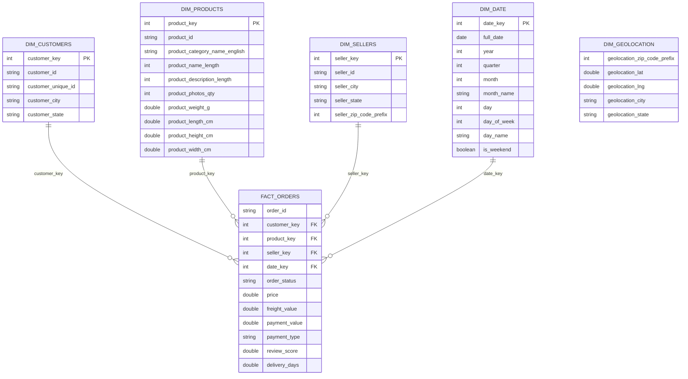

# ⭐ Lược đồ Star Schema — Olist Analytics (`olist_analytics.duckdb`)

Lược đồ Star Schema thiết kế cho bài toán phân tích dữ liệu thương mại điện tử Olist trong DuckDB. Bảng sự kiện `fact_orders` có độ chi tiết (**grain**) ở mức **một dòng trên mỗi mặt hàng trong đơn hàng** (`order_item`), lưu các đại lượng đo lường và liên kết tới các bảng chiều (`dim_*`).

---

## Sơ đồ Thực thể – Quan hệ (ERD)

> **Ghi chú:** `dim_geolocation` có thể kết nối bổ sung qua mã vùng bưu chính (`geolocation_zip_code_prefix` ↔ `seller_zip_code_prefix`) khi phân tích bản đồ tọa độ địa lý (`lat` / `lng`).

---

## Kiểm chứng dữ liệu thực tế trong DuckDB

| Bảng | Loại | Số dòng | Vai trò chính |
|---|---|---:|---|
| `fact_orders` | **FACT** | `112,650` | Giao dịch đơn hàng/sản phẩm, giá, cước vận chuyển, thanh toán, điểm đánh giá, số ngày giao |
| `dim_customers` | **DIMENSION** | `99,441` | Thông tin định danh và vị trí (thành phố, bang) của khách hàng |
| `dim_products` | **DIMENSION** | `32,951` | Danh mục sản phẩm (đã dịch tiếng Anh) và kích thước/khối lượng |
| `dim_sellers` | **DIMENSION** | `3,095` | Thông tin định danh và vị trí (thành phố, bang, mã vùng) của người bán |
| `dim_date` | **DIMENSION** | `1,461` | Chuỗi lịch ngày (`2016-01-01` → `2019-12-31`), năm, quý, tháng, thứ, cuối tuần |
| `dim_geolocation` | **DIMENSION** | `19,015` | Tọa độ vĩ độ/kinh độ theo mã vùng bưu chính Brazil |
