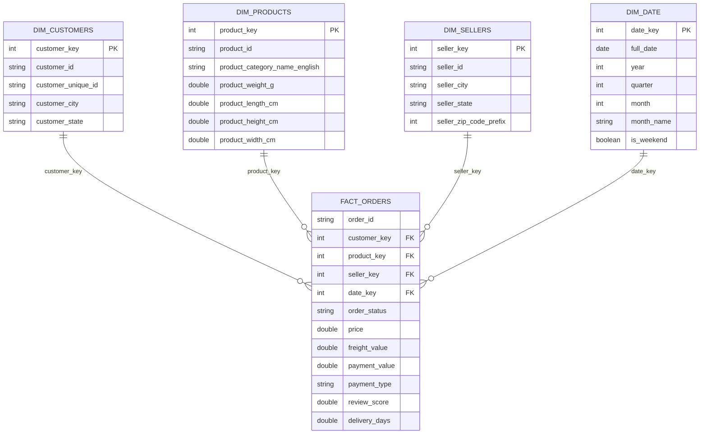

# Olist Star Schema

The fact table grain is one row per order item. Measures are stored in `fact_orders`, while descriptive attributes are stored in dimension tables.

## Database validation

- `fact_orders`: 112,650 rows
- `dim_customers`: 99,441 rows
- `dim_products`: 32,951 rows
- `dim_sellers`: 3,095 rows
- `dim_date`: 1,461 rows
- `dim_geolocation`: 19,015 rows
